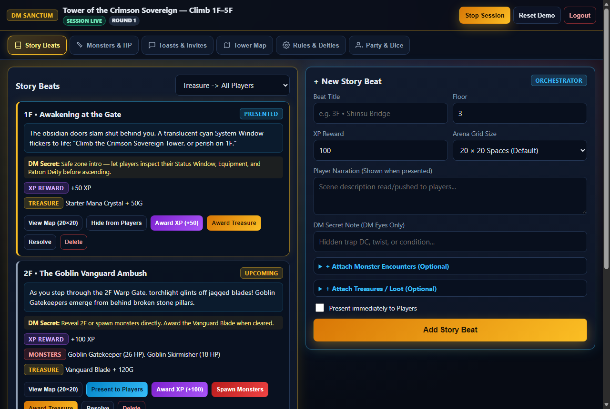

# The Tower — DnD Companion App (`v0.2`)

A mobile-friendly, real-time **Dungeons & Dragons & Korean Manhwa Tower RPG** virtual tabletop and companion app. Built with a single centralized login portal that routes **Dungeon Masters** and **Players (Climbers)** into tailored interfaces, synchronized in real time via Server-Sent Events (SSE).


---

## Screenshots

| Mobile-First Player Dashboard | DM Sanctum — Story Beats Orchestrator |
| :---: | :---: |
|  |  |

### Story Beat Tactical Arena Map (`20×20` Default, Adjustable Spaces & Start Positions)


---

## What's Implemented

### 1. Centralized Login & Role Routing
- **Single Login Screen (`The Tower — DnD Companion App`)**: One glassmorphic **Username or Email + Password** form automatically routes users to the **DM Sanctum** or **Player Dashboard** based on their credentials.
- **Mock Demo Credentials**:
  - **Dungeon Master**: `admin` / `123456` (or `DM_PASSCODE`)
  - **Player**: `player` / `123456`
- **Email-Whitelisted Onboarding & Account Settings**: DMs can whitelist player emails in **Toasts & Invites**; first-time players activate with their invited email + new password and can update their username/password anytime in **Account** (salted `crypto.scryptSync` + timing-safe comparison).

### 2. DM Sanctum & Story Beats Orchestrator
- **Story Beats First**: The DM lands directly on **Story Beats**, where each beat tracks Floor, Player Narration, DM Secret Notes, XP Reward, multiple Monster Encounters (with optional `Start X / Start Y`), and multiple Treasures/Loot.
- **Live Orchestration**:
  - **Present to Players**: Broadcasts the beat's narration as a `[STORY]` toast and displays the active scene card on the Player Dashboard.
  - **Spawn Monsters / Award Treasure / Award XP**: Summons all attached monsters directly onto the beat's arena and Live Monster HP tracker, awards Gold/Mana Stones/items to chosen players, and grants XP.
- **View Map (Isolated Story Beat Arena)**:
  - Defaults to **`20×20` Spaces**, with quick presets (`20×20`, `25×25`, `30×30`, `40×40`, `50×50`) and custom `Cols × Rows` sizing.
  - Shows **only** the players toggled into the fight, the monsters spawned for that beat, and the arena grid with coordinate axes, `Space - / +` width controls, **Save Start Positions**, and **Reset to Start**.
- **Session Control & System Toasts**: Start/Stop live sessions and broadcast categorized `[SYSTEM]` toast alerts (`info`, `combat`, `warning`, `loot`).

### 3. Mobile-First Player Dashboard
- **Sticky Bottom Icon Dock**: Quick phone navigation across **Stats**, **Gear**, **Bag**, **Magic**, **Tower**, **Dice**, and **Art**.
- **XP, Level-Up & Stat Allocation**:
  - All characters start at **Level 1** (`0 / 100 XP`) with **10 free stat points** to allocate freely (`+1` buttons on any attribute).
  - Every level up (`level * 100` XP threshold) grants **+2 stat points**.
- **Real-Time Monster HP & Reactive Combat**:
  - Inspect live monster HP bars, deal direct or weapon-formula damage, and respond to DM-triggered monster attacks in **Reactive** mode with **Counter**, **Parry**, **Spell**, or **Take Hit**.
- **Equipment & Inventory**: 6 gear slots (`Main Hand`, `Off-Hand`, `Head`, `Body`, `Boots`, `Relic`), filterable backpack, consumable healing, and custom item creation.
- **Free-Flow Magic & Patron Deities**: Learn or craft spells with full mechanical explanations, damage formulas, and ranges in **Spaces**; pledge to a Patron Deity (with Google Docs lore import) and spend Divine Favor on Miracles.
- **Polyhedral & Percentile Dice (`d2`–`d100`)**: One-tap dice from `d2` up to `d100` plus custom `1–100` sided rolls with Normal, Advantage, Disadvantage, and Exploding modes.
- **AI Character Art as Map Icons**: Push a text prompt and style to generate a bespoke character portrait (`GEMINI_API_KEY` Imagen 3 when configured, or built-in SVG synthesis) that automatically renders as the player's token icon on both the **Story Beat Map** and **Vertical Tower Map**, complete with hover and touch-hold name/HP tooltips.

### 4. Custom Game Mechanics Builder
- Customize attribute definitions (`STR`, `AGI`, `VIT`, `INT`, `PER`, `LUCK`, or custom stats), safe math formulas (`Stat Modifier`, `Hit Check`, `Damage Inflicted`, `Crit Multiplier`), resource names, and `Reactive` vs `Turn-Based` combat flow.

---

## Tech Stack & Project Structure
- **Backend**: Zero-dependency Node.js (`http`, `fs`, `path`, `crypto`) with Server-Sent Events (`/api/events`) and JSON persistence (`data/state.json`).
- **Frontend**: Vanilla HTML5, CSS3, and HTML5 Canvas (`public/`).

```text
dnd-vtt/
├── server.js          # HTTP server, SSE broadcaster, auth, formula engine, game actions
├── test.js            # Automated integration test suite (12 suites)
├── package.json       # Scripts (start, test) and Node engine config
├── render.yaml        # Render Free Web Service blueprint
├── Dockerfile         # Container setup for Koyeb / Fly / Docker hosts
├── docs/images/       # README screenshots
└── public/
    ├── index.html     # Single login portal, Player dashboard, DM Sanctum & arena modal
    ├── styles.css     # Mobile-friendly dark fantasy & System UI theme
    └── app.js         # Client state sync, arena & tower canvas renderers, dice & sheet logic
```

---

## Getting Started

### Run Locally
```bash
npm start
```
Open `http://localhost:3456` (or `http://<your-local-IP>:3456` on mobile devices on the same network).

### Run Automated Tests
```bash
npm test
```

## Free Hosting (Render / Docker)
1. Push this repository to GitHub.
2. On **Render**, create a **Blueprint** (uses `render.yaml`) or **Web Service** on the **Free** tier (`$0/month`).
3. Set `DM_PASSCODE` (and optionally `GEMINI_API_KEY`) in Environment Variables and deploy.
