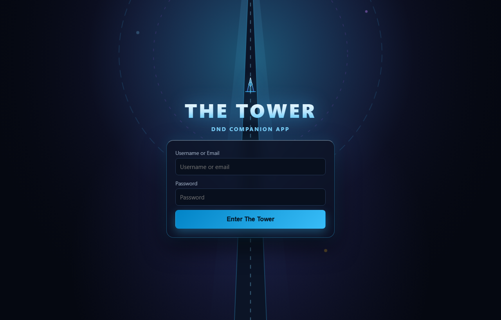

# The Tower — DnD Companion App (`v0.3`)

A mobile-friendly, real-time **Dungeons & Dragons & Korean Manhwa Tower RPG** virtual tabletop and companion app. Built with a single centralized login portal that routes **Dungeon Masters** and **Players (Climbers)** into tailored interfaces, synchronized in real time via Server-Sent Events (SSE).



---

## Screenshots

| Mobile-First Player Dashboard | DM Sanctum — Story Beats Orchestrator |
| :---: | :---: |
|  |  |

### Story Beat Tactical Arena Map (`20×20` Default, Biomes, Terrain, NPCs & Chests)


---

## What's Implemented

### 1. Centralized Login & Role Routing
- **Single Login Screen (`The Tower — DnD Companion App`)**: One glassmorphic **Username or Email + Password** form automatically routes users to the **DM Sanctum** or **Player Dashboard** based on their credentials.
- **Mock Demo Credentials**:
  - **Dungeon Master**: `admin` / `123456` (or `DM_PASSCODE`)
  - **Player**: `player` / `123456`
- **Email-Whitelisted Onboarding & Character Inspection**: DMs manage player email invites in the **Invites** tab, view any character's **85%-viewport Profile Modal** (AI character art, stats, equipment, inventory, and personal log history), and inspect the **All Players Log History** feed. First-time players activate with their invited email + new password and can update their username/password anytime in **Account** (salted `crypto.scryptSync` + timing-safe comparison).

### 2. DM Sanctum, Story Beats & Full-Screen Scene View
- **DM Navigation**: Streamlined across **Story Beats**, **Tower Map**, **Rules & Deities**, **Party & Dice**, and **Invites** (rightmost), plus a top-bar **Session Controls** modal (`Start / Stop Session` with custom title & paused message).
- **Full-Screen `View Beat` Workspace & Editor**:
  - Opens a dedicated full-screen scene view (with a **`← Back`** button returning to your previous view/scroll) showing the **Real-Time Arena Map**, **Stat-Based Initiative & Turn Order** (`AGI`/`AC` modifiers), **Players & Live Stats**, **Spawned Monsters**, **Treasure & Loot Chests**, **NPCs**, and a quick **Send Toast to Players** panel (all toast messages automatically prefixed with `SYSTEM: `).
  - Includes an inline **Edit Beat** panel to update Title, Floor, XP, Grid Size, Narration, DM Secrets, Monster Encounters, NPCs, and Treasures.
- **Arena Designer, Biomes, Impassable Terrain & Cryptic Auto-Gen**:
  - Selectable **Arena Backgrounds** (`Obsidian Tower`, `Forest`, `Plains`, `Desert`), **Tree / Rock / Water** impassable terrain brushes (movement onto terrain is blocked), and **Auto-Generate Map** from a cryptic text description.
  - Set precise starting positions for players, monsters, NPCs, and interactive **Treasure Chests** (`20×20` default up to `50×50` or custom `Cols × Rows`).
- **Interactive NPCs & Monster Loot Drops**:
  - Place **NPCs** with custom dialogue and one-time rewards (**Item**, **Skill Book** added to inventory & learned skills, or **XP**) claimed when players talk to them on the arena.
  - Attach **Loot Drops** (`Item`, `Gold`, `Mana Stones`, `XP`) to monsters so defeated monsters (`0 HP`) automatically drop a lootable chest on the arena or award loot to the party.
- **Themed Tower Floors**:
  - Starts on **1F** (`Forest`), with **Tower Theme Designer** presets (`1F Forest -> 2F Desert -> 3F Underworld`), per-floor theme pickers, **Players & Story Beats per Floor** overviews, and **Delete Floor** with confirmation.

### 3. Mobile-First Player Dashboard
- **Sticky Bottom Icon Dock**: Quick phone navigation across **Stats**, **Gear**, **Bag**, **Magic**, **Tower**, **Dice**, and **Art**.
- **XP, Level-Up & Stat Milestone Awakenings (`20 / 40 / 60 / 80 / 100`)**:
  - All characters start at **Level 1** (`0 / 100 XP`) with **10 free stat points** to allocate freely (`+1` buttons on any attribute); every level up (`level * 100` XP) grants **+2 stat points**.
  - Reaching **`20`, `40`, `60`, `80`, and `100`** in `STR`, `AGI`, `VIT`, `INT`, `PER`, or `LUCK` automatically unlocks **Awakened Milestone Abilities** (e.g., `Titan Cleave`, `Phantom Step`, `Immortal Vessel`, `Archmage Resonance`, `True Sight`, `Fatebreaker`).
- **Real-Time Monster HP & Reactive Combat**:
  - Inspect live monster HP bars, deal direct or weapon-formula damage, and respond to DM-triggered monster attacks in **Reactive** mode with **Counter**, **Parry**, **Spell**, or **Take Hit**.
- **Equipment, Inventory & Party Inspector**: 6 gear slots (`Main Hand`, `Off-Hand`, `Head`, `Body`, `Boots`, `Relic`), filterable backpack, and full stats/equipment/inventory inspection + **View Character** modal in **Party & Dice**.
- **Free-Flow Magic & Patron Deities**: Learn or craft spells with full mechanical explanations, damage formulas, and ranges in **Spaces**; pledge to a Patron Deity (with Google Docs lore import) and spend Divine Favor on Miracles.
- **Graphical Polyhedral Dice Tray (`d4`–`d100`)**: Animated SVG polyhedral dice simulation (`d4`, `d6`, `d8`, `d10`, `d12`, `d20`, `d100`) with quick-roll buttons in both Player and DM Dice Trays, plus Normal, Advantage, Disadvantage, Exploding, and Secret DM roll modes.
- **AI Character Art as Map Icons**: Generate a bespoke character portrait (`GEMINI_API_KEY` Imagen 3 when configured, or built-in SVG synthesis) that renders as the player's token icon with hover and touch-hold tooltips.

### 4. Custom Game Mechanics Builder
- Customize attribute definitions (`Stat Key`, `Stat Name`, `Starting Value`), grouped **Stat Milestone Abilities (`20 / 40 / 60 / 80 / 100`)**, safe math formulas (`Stat Modifier`, `Hit Check`, `Damage Inflicted`, `Crit Multiplier`), resource names, and `Reactive` vs `Turn-Based` combat flow.

---

## Tech Stack & Project Structure
- **Backend**: Zero-dependency Node.js (`http`, `fs`, `path`, `crypto`) with Server-Sent Events (`/api/events`) and JSON persistence (`data/state.json`).
- **Frontend**: Vanilla HTML5, CSS3, and HTML5 Canvas (`public/`).

```text
dnd-vtt/
├── server.js          # HTTP server, SSE broadcaster, auth, formula engine, game actions
├── test.js            # Automated integration test suite (12 suites)
├── package.json       # Scripts (start, test) and Node engine config
├── render.yaml        # Render Free Web Service blueprint
├── Dockerfile         # Container setup for Koyeb / Fly / Docker hosts
├── docs/images/       # README screenshots
└── public/
    ├── index.html     # Single login portal, Player dashboard, DM Sanctum & arena modal
    ├── styles.css     # Mobile-friendly dark fantasy & System UI theme
    └── app.js         # Client state sync, arena & tower canvas renderers, dice & sheet logic
```

---

## Getting Started

### Run Locally
```bash
npm start
```
Open `http://localhost:3456` (or `http://<your-local-IP>:3456` on mobile devices on the same network).

### Run Automated Tests
```bash
npm test
```

## Free Hosting (Render / Docker)
1. Push this repository to GitHub.
2. On **Render**, create a **Blueprint** (uses `render.yaml`) or **Web Service** on the **Free** tier (`$0/month`).
3. Set `DM_PASSCODE` (and optionally `GEMINI_API_KEY`) in Environment Variables and deploy.
