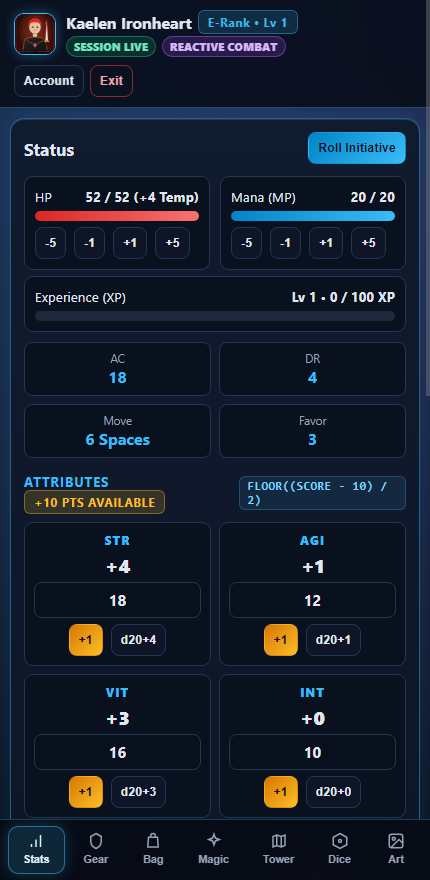
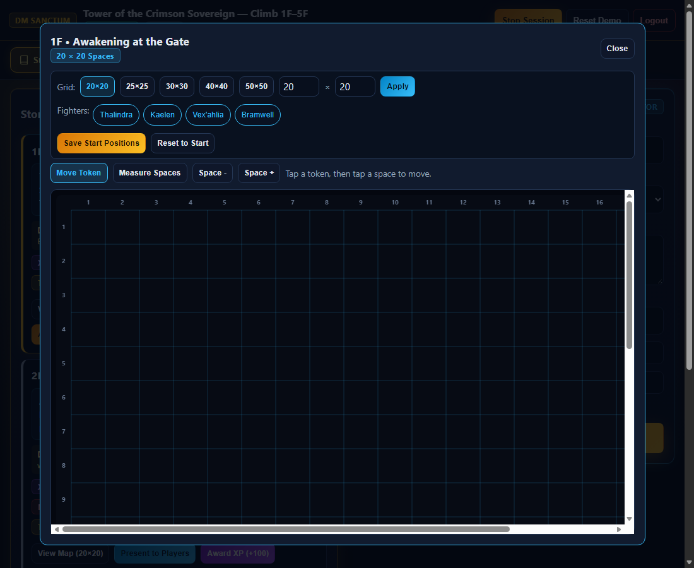

# The Tower — DnD Companion App (`v0.5`)

A mobile-friendly, real-time **Dungeons & Dragons & Korean Manhwa Tower RPG** virtual tabletop and companion app built with **Full-Stack TypeScript, React 18 (Vite), and Fastify**, synchronized live across Dungeon Masters and Players via **Server-Sent Events (SSE)**.


---

## Screenshots

| Mobile-First Player Dashboard | DM Sanctum — Story Beats Orchestrator |
| :---: | :---: |
|  |  |

### Story Beat Tactical Arena Map (`20×20` Default, Biomes, Terrain, NPCs & Chests)


---

## What's Implemented (`Version 0.5`)

### 1. Security, Signed Cookie Sessions & RBAC Onboarding
- **Two-Step Authentication (`The Tower — DnD Companion App`)**: Clean glassmorphic **Username or Email -> Password** login flow with **no mock accounts or demo quick-login shortcuts**.
- **Signed `HttpOnly` Session Cookies & Server-Side RBAC**: Authenticated sessions use HMAC-SHA256 signed `HttpOnly` cookies (`tower_vtt_session`, `SameSite=Lax`) alongside `@fastify/helmet` CSP headers and `@fastify/rate-limit`. All `/api/state`, `/api/events`, `/api/action`, and `/api/auth/update-credentials` routes strictly derive identity from the verified session cookie and ignore spoofed `role`, `characterId`, or `email` parameters.
- **DM Access & First-Time Setup**:
  - DM login via `admin` + `DM_PASSCODE` (defaults to `dm123` unless overridden in env).
  - First-time DM email setup flow (`/api/auth/dm-setup`) with reserved username enforcement (`admin`, `dm`, `dungeonmaster`, `dm@tower.gg` cannot be claimed by players).
- **Email-Whitelisted Invites & 4-Step Onboarding Wizard**:
  - DMs invite player emails in **Invites** (binding or auto-creating a character and seeding their token onto active story beat arenas).
  - Players set their password on first login using `crypto.scryptSync` + timing-safe verification, then complete the **4-Step Awakening Wizard** (Profile, Starter Kit or Custom Wooden Weapon even while a live story beat is active, Custom Portrait Upload or AI Portrait Art, and Mechanics Overview).

### 2. Player Dashboard, View-Only Session Bar & Account Modals
- **4-Tab Navigation + Live Session Status Indicator**: Quick mobile & desktop tabs across **Stats**, **Equipment & Inventory**, **Spells**, and **Tower**, paired with a tab-bar status indicator (**`SESSION STARTED`** vs **`SESSION STOPPED (VIEW ONLY)`**). When the session is stopped, players can freely inspect all 4 tabs and use read-only inventory category filters (`All`, `Weapons`, `Armor`, `Potions`, `Relics`) while interactive gameplay actions stay locked.
- **85%-Viewport Modals (`85vw × 85vh`)**:
  - **Account Settings Modal**: Update username/password, upload a custom character portrait (`image/*` compressed client-side), switch cleanly between **`Use Uploaded Image`** and **`Use AI-Generated Art`**, or pick from a deduplicated portrait history gallery (`GEMINI_API_KEY` Imagen 3 when configured, or built-in SVG synth).
  - **DM Character Profile Modal**: Inspect any player's portrait gallery, stats, passives, Diablo-style equipped gear, inventory, and chronological activity history (newest first).

### 3. Progression, Passive Gacha, Magic & Tactical Combat (`1F–100F`)
- **XP, Level-Up & Stat Milestone Awakenings (`20 / 40 / 60 / 80 / 100`)**: Characters start at **Level 1** (`0 / 100 XP`) with **10 unspent stat points** and gain `+2 Stat Points + 1 Passive Ticket` per level-up. Crossing `20`, `40`, `60`, `80`, and `100` unlocks Awakened Abilities (and prevents refunding stats below unlocked milestone thresholds).
- **200-Skill Passive Gacha**: 7-tier pool (`Normal` 55%, `Advanced` 22%, `Rare` 12%, `Super Rare` 6%, `Super Super Rare` 3%, `Legendary` 1.5%, `Mythic` 0.5%) with duplicate stack multipliers (`+50%, +60%, +70%...`), floor-scaled Gold + XP decline rewards, full **Resume Pending Draw** modal recovery, and persistent AC/DR recalculation across equip/unequip.
- **Free-Flow 6-Element Magic**: Learn or craft spells (`Fire`, `Earth`, `Wind`, `Water`, `Light`, `Dark`) gated by `getSpellCraftLimits(floor)` and `getMaxSpellsForLevel(level)`, with MP validation and `Reaction` spell resolution during incoming attacks.
- **Equipment, Inventory & Player Trading**: 6-slot Diablo-style gear grid (`Main Hand`, `Off-Hand`, `Head`, `Body`, `Boots`, `Relic`), filterable backpack, consumable restoration items, and player-to-player item quantity trades.
- **Real-Time Tactical Arena (`20×20` to `50×50`), Reactive Combat & Turn Rules**:
  - Fire Emblem Manhattan movement (`|dx| + |dy| <= speedSpaces`), impassable seeded terrain (`Tree`, `Rock`, `Water`), PER-based **Observe** weak-spot discovery (with explicit modifier preservation and HP masking/health tiers when `showExactMonsterHpToPlayers` is disabled), ranged line-of-sight with friendly-fire resolution, chests (`0` gold/stones preserved), NPCs (dialogue & skill book / item / XP gifts), and **Reactive** **Counter / Parry / Spell / Take Hit** banners inside both `PlayerView` and `BeatDetailView`.
  - Authoritative turn order checks on `End Turn` and zoomed canvas tooltip scaling (`cellPx`).

### 4. DM Sanctum, Mechanics Builder & Atomic Persistence
- **DM Workspace Tabs**: **Story Beats**, **Tower Map**, **Rules & Deities**, **Party & Dice**, and **Invites** (with dirty-state tracking so live player SSE rolls never overwrite unsaved DM notes or mechanics edits).
- **Deterministic Terrain Preview**: Shared seeded `generateArenaTerrainFromPrompt` ensures the DM draft preview matches the saved arena map 1:1.
- **Validated Game Mechanics & Deities**: Live formula syntax validation (`Stat Modifier`, `Hit Check`, `Damage Inflicted`), custom stats & milestones, `Reactive` vs `Turn-Based` combat modes, monster HP masking (`showExactMonsterHpToPlayers`), graphical SVG polyhedral dice (`d4`–`d100`), and Patron Deity Google Docs importer.
- **Atomic Persistence (`JsonStateRepository`)**: Atomic temp-file + rename writes to `data/state.json`, rotating backups in `data/backups/`, automatic backup recovery if `state.json` is corrupted, and `schemaVersion: 2` backward-compatible state migrations.

---

## Tech Stack & Project Structure

- **Backend**: TypeScript + Fastify 5 (`@fastify/cookie`, `@fastify/helmet`, `@fastify/rate-limit`, `@fastify/static`, `zod`) with SSE (`/api/events`) and `JsonStateRepository`.
- **Frontend**: React 18 + TypeScript + Vite 6 + HTML5 Canvas (`client/src/`).
- **Shared Domain Layer**: Single source of truth for types, safe recursive-descent math evaluation, gacha pools, starter kits, floor scaling rules, and deterministic terrain (`shared/`).

```text
dnd-vtt/
├── shared/                     # Consolidated domain logic shared by server & client
│   ├── types.ts                # Core interfaces (GameState, Character, Monster, StoryBeat, Session)
│   ├── formulas.ts             # evaluateFormula parser, grid/line math, getArenaCellPx
│   ├── rules.ts                # Floor scaling, spell clamping, locks, AC/DR & stat helpers
│   ├── passiveSkills.ts        # 200-skill 7-tier gacha catalog & bonus summarizer
│   ├── starterKits.ts          # Starter kits & custom wooden weapon loadouts
│   ├── terrain.ts              # Deterministic seeded arena terrain generator
│   └── index.ts
├── server/src/                 # Fastify backend
│   ├── index.ts / app.ts / config.ts
│   ├── auth/                   # scrypt passwords & HMAC-SHA256 HttpOnly cookie sessions
│   ├── routes/                 # /health, /api/auth/*, /api/state, /api/events, /api/action
│   ├── actions/                # Zod-validated handlers (session, combat, character, item, map, story)
│   ├── services/               # dice, art, deities & shared state mutation helpers
│   ├── realtime/               # Role- & character-filtered SSE broadcaster
│   └── store/                  # initialState, filterState/HP masking, JsonStateRepository
├── client/                     # React + Vite frontend
│   ├── index.html
│   ├── vite.config.ts / tsconfig.json
│   └── src/
│       ├── main.tsx / App.tsx
│       ├── context/            # VttContext (cookie bootstrap, SSE sync, toasts, modals)
│       ├── services/           # apiFetch & sendGameAction
│       ├── canvas/             # Scaled canvas coordinates & Tower / Beat arena renderers
│       ├── components/         # auth/, onboarding/, player/, dm/, arena/, modals/, common/
│       └── styles/             # base.css, login.css, layout.css, game.css, index.css
├── tests/
│   └── integration.test.ts     # 16 unit, persistence, RBAC & full campaign integration suites
├── package.json / tsconfig.base.json / tsconfig.server.json
├── Dockerfile                  # Multi-stage Node 20 Alpine production build
├── render.yaml                 # Render Web Service blueprint
└── docs/images/                # README screenshots
```

---

## Getting Started

### Prerequisites
- Node.js `>= 18.0.0` (verified on Node `v20.16.0`)

### Install, Build & Run Production Server
```bash
npm install
npm run build
npm start
```
Open `http://localhost:3456` (or `http://<your-local-IP>:3456` on other devices on the same network).

### Development Mode
Run the backend watcher and Vite dev server (`http://localhost:5173`, proxied to `:3456`) in two terminals:
```bash
npm run dev:server
npm run dev:client
```

### Typecheck & Automated Tests
```bash
npm run typecheck
npm test
```
(`npm test` runs `tsx tests/integration.test.ts` across all 16 suites: shared rules/determinism, `JsonStateRepository` atomic persistence & backup recovery, HttpOnly cookie RBAC & security headers, and full DM/Player campaign workflows.)

---

## Hosting (Render / Docker)
1. Push this repository to GitHub (`main`).
2. On **Render**, create a **Blueprint** (`render.yaml`, runs `npm ci && npm run build` and `npm start`) or deploy with the multi-stage [Dockerfile](Dockerfile).
3. Configure environment variables:
   - `NODE_ENV=production`
   - `DM_PASSCODE` (your Dungeon Master passcode)
   - `SESSION_SECRET` (auto-generated in `render.yaml` or any random 32+ char secret)
   - `GEMINI_API_KEY` (optional — enables AI Imagen portrait generation)
