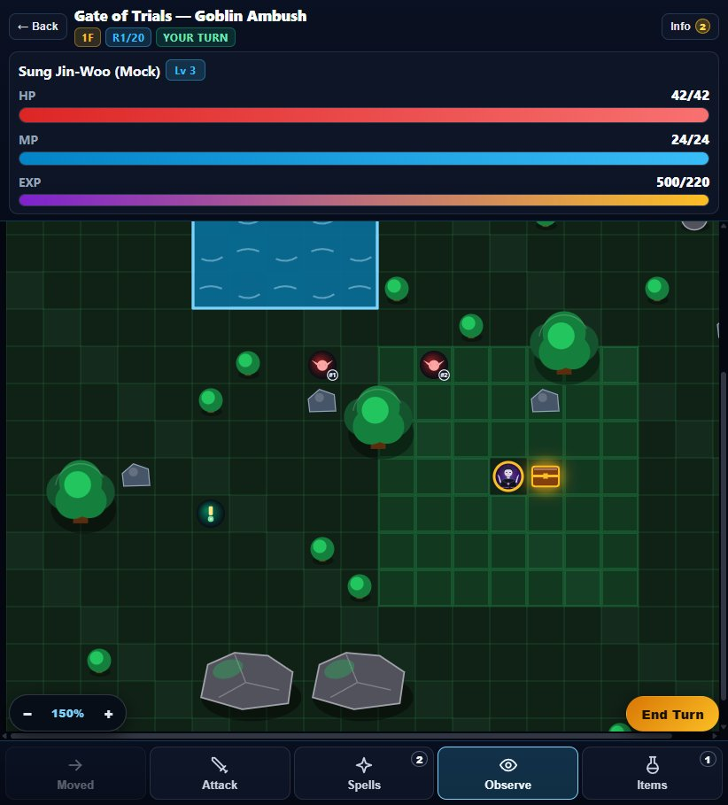
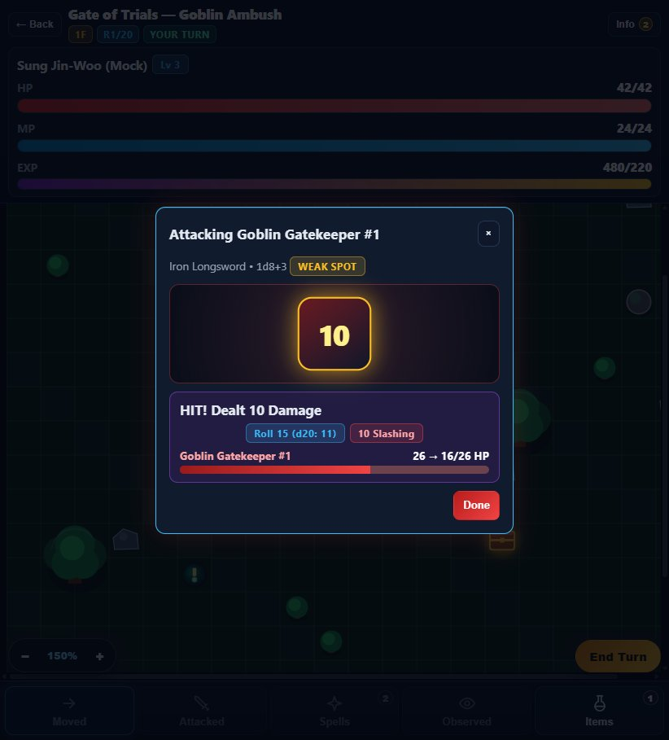
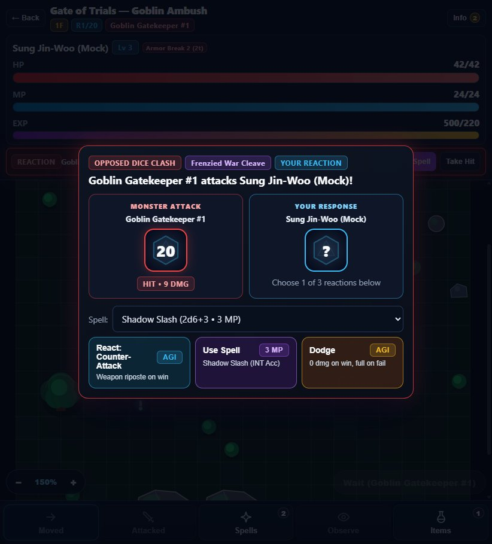
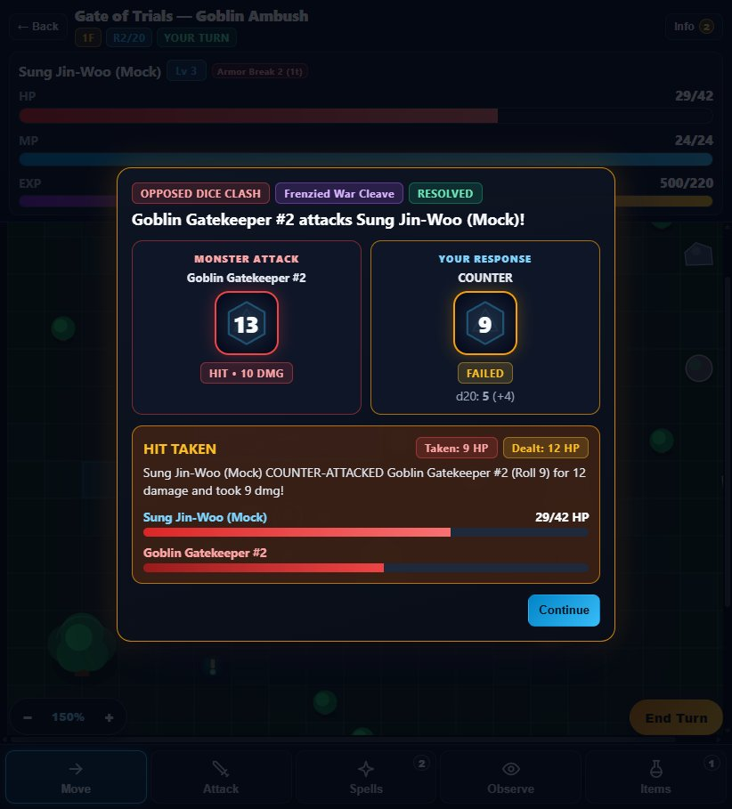

# The Tower — DnD Companion App (`v0.7.1`)

A mobile-friendly, real-time **Dungeons & Dragons & Korean Manhwa Tower RPG** virtual tabletop and companion app built with **Full-Stack TypeScript, React 18 (Vite), and Fastify**, synchronized live across Dungeon Masters and Players via **Server-Sent Events (SSE)**.


---

## Screenshots

| Mobile-First Player Dashboard | DM Sanctum — Story Beats Orchestrator |
| :---: | :---: |
|  |  |

### Story Beat Tactical Arena Map (`20×20` Default, Biomes, Terrain, NPCs & Chests)


### Version 0.7 Showcase — Mobile Combat HUD, 3-Column Attack Roll & Streamlined Opposed Clash
| Mobile Combat HUD & Observe Line-of-Sight | 3-Column Attack & Damage Roll Modal |
| :---: | :---: |
|  |  |

| Streamlined Opposed Clash (3 Choices) | Clash Resolved (Player & Masked Monster HP Bars) |
| :---: | :---: |
|  |  |

---

## What's Implemented (`Version 0.7.1`)

### 1. Security, Signed Cookie Sessions & RBAC Onboarding
- **Two-Step Authentication (`The Tower — DnD Companion App`)**: Clean glassmorphic **Username or Email -> Password** login flow with **no mock accounts or demo quick-login shortcuts**.
- **Signed `HttpOnly` Session Cookies & Server-Side RBAC**: Authenticated sessions use HMAC-SHA256 signed `HttpOnly` cookies (`tower_vtt_session`, `SameSite=Lax`) alongside `@fastify/helmet` CSP headers and `@fastify/rate-limit`. All `/api/state`, `/api/events`, `/api/action`, and `/api/auth/update-credentials` routes strictly derive identity from the verified session cookie and ignore spoofed `role`, `characterId`, or `email` parameters.
- **DM Access & First-Time Setup**:
  - DM login via `admin` + `DM_PASSCODE` (defaults to `dm123` unless overridden in env).
  - First-time DM email setup flow (`/api/auth/dm-setup`) with reserved username enforcement (`admin`, `dm`, `dungeonmaster`, `dm@tower.gg` cannot be claimed by players).
- **Email-Whitelisted Invites & 4-Step Onboarding Wizard**:
  - DMs invite player emails in **Invites** (binding or auto-creating a character and seeding their token onto active story beat arenas).
  - Players set their password on first login using `crypto.scryptSync` + timing-safe verification, then complete the **4-Step Awakening Wizard** (Profile, Starter Kit or Custom Wooden Weapon even while a live story beat is active, Custom Portrait Upload or AI Portrait Art, and Mechanics Overview).

### 2. Player Dashboard, View-Only Session Bar & Account Modals
- **4-Tab Navigation + Live Session Status Indicator**: Quick mobile & desktop tabs across **Stats**, **Equipment & Inventory**, **Spells**, and **Tower**, paired with a tab-bar status indicator (**`SESSION STARTED`** vs **`SESSION STOPPED (VIEW ONLY)`**). When the session is stopped, players can freely inspect all 4 tabs and use read-only inventory category filters (`All`, `Weapons`, `Armor`, `Potions`, `Relics`) while interactive gameplay actions stay locked.
- **85%-Viewport Modals (`85vw × 85vh`)**:
  - **Account Settings Modal**: Update username/password, upload a custom character portrait (`image/*` compressed client-side), switch cleanly between **`Use Uploaded Image`** and **`Use AI-Generated Art`**, or pick from a deduplicated portrait history gallery (`GEMINI_API_KEY` Imagen 3 when configured, or built-in SVG synth).
  - **DM Character Profile Modal**: Inspect any player's portrait gallery, stats, passives, Diablo-style equipped gear, inventory, and chronological activity history (newest first).

### 3. Progression, Passive Gacha, Magic & Tactical Combat (`1F–100F`)
- **XP, Level-Up & Stat Milestone Awakenings (`20 / 40 / 60 / 80 / 100`)**: Characters start at **Level 1** (`0 / 100 XP`) with **10 unspent stat points** and gain `+2 Stat Points + 1 Passive Ticket` per level-up. Crossing `20`, `40`, `60`, `80`, and `100` unlocks Awakened Abilities (and prevents refunding stats below unlocked milestone thresholds).
- **200-Skill Passive Gacha**: 7-tier pool (`Normal` 55%, `Advanced` 22%, `Rare` 12%, `Super Rare` 6%, `Super Super Rare` 3%, `Legendary` 1.5%, `Mythic` 0.5%) with duplicate stack multipliers (`+50%, +60%, +70%...`), floor-scaled Gold + XP decline rewards, full **Resume Pending Draw** modal recovery, and persistent AC/DR recalculation across equip/unequip.
- **Free-Flow 6-Element Magic**: Learn or craft spells (`Fire`, `Earth`, `Wind`, `Water`, `Light`, `Dark`) gated by `getSpellCraftLimits(floor)` and `getMaxSpellsForLevel(level)`, with MP validation and `Reaction` spell resolution during incoming attacks.
- **Equipment, Inventory & Player Trading**: 6-slot Diablo-style gear grid (`Main Hand`, `Off-Hand`, `Head`, `Body`, `Boots`, `Relic`), filterable backpack, consumable restoration items, and player-to-player item quantity trades.
- **Real-Time Tactical Arena (`20×20` to `50×50`), Reactive Combat & Turn Rules**:
  - Fire Emblem Manhattan movement (`|dx| + |dy| <= speedSpaces`), impassable seeded terrain (`Tree`, `Rock`, `Water`), PER-based **Observe** weak-spot discovery (with explicit modifier preservation and HP masking/health tiers when `showExactMonsterHpToPlayers` is disabled), ranged line-of-sight with friendly-fire resolution, chests (`0` gold/stones preserved), NPCs (dialogue & skill book / item / XP gifts), and **Reactive** **Counter / Parry / Spell / Take Hit** banners inside both `PlayerView` and `BeatDetailView`.
  - Authoritative turn order checks on `End Turn` and zoomed canvas tooltip scaling (`cellPx`).

### 4. DM Sanctum, Mechanics Builder & Atomic Persistence
- **DM Workspace Tabs**: **Story Beats**, **Tower Map**, **Rules & Deities**, **Party & Dice**, and **Invites** (with dirty-state tracking so live player SSE rolls never overwrite unsaved DM notes or mechanics edits).
- **Deterministic Terrain Preview**: Shared seeded `generateArenaTerrainFromPrompt` ensures the DM draft preview matches the saved arena map 1:1.
- **Validated Game Mechanics & Deities**: Live formula syntax validation (`Stat Modifier`, `Hit Check`, `Damage Inflicted`), custom stats & milestones, `Reactive` vs `Turn-Based` combat modes, monster HP masking (`showExactMonsterHpToPlayers`), graphical SVG polyhedral dice (`d4`–`d100`), and Patron Deity Google Docs importer.
- **Atomic Persistence (`JsonStateRepository`)**: Atomic temp-file + rename writes to `data/state.json`, rotating backups in `data/backups/`, automatic backup recovery if `state.json` is corrupted, and `schemaVersion: 2` backward-compatible state migrations.

### 5. Tactical Combat, Status Effects, Round Limits, Multi-Tile Terrain & Unit Icons (`v0.6`)
- **Attack Area & Size Modifiers**: Configurable attack shapes and `-2` to `+4` Space size modifiers across player weapons, spells, and skills as well as monster basic attacks and skills, with live directional aiming previews on the arena grid.
- **Strict Turn Enforcement & BFS Pathfinding**: Enforces active-turn ownership for both players and monsters, single-move-per-turn rules, a DM **End Turn** action in monster controls, and realistic BFS movement pathfinding that routes around impassable obstacles.
- **Multi-Tile Theme-Aware Terrain & Auto-Generate Map**: Generates floor-themed `2×2` trees, `3×2` boulders, organic rivers/lakes, pillars, crystals, and lava/ice clusters via one-click **Auto-Generate Map**.
- **Heal HP, Buffs & Debuffs**: Full tactical suite (`shield`, `empower`, `haste`, `regen`, `burn`, `poison`, `armor_break`, `weaken`, `slow`, `stun`) with automatic start-of-turn DoT/regen ticking & turn expiry, Beat Arena quick actions, and configuration in Bestiary Monsters/Skills, Custom Spells, and Main Hand Weapons.
- **Combat Round Limits & Timeout Penalties**: Default `20`-round limit (DM-editable per combat beat) with live `ROUND X / Y` HUD pills, urgent warnings in the final 3 rounds, Standard Tower timeout defeat penalties (`-25%` HP min 1, `-25%` MP, `-20%` Gold, `-15%` XP), Defeat Summary banner, and DM **Retry Battle** reset.
- **Vector Monster & NPC Icons**: Crisp auto-matched vector silhouettes (13 monster archetypes + 8 NPC archetypes) rendered on the arena canvas, Spawned Monster cards, Initiative Order, and Bestiary/NPC editors, complete with golden Boss crowns/auras, `#1`/`#2` numbered corner pips, and DM icon overrides.

### 6. Mobile Combat HUD, Opposed Clash, Observe LoS, NPC Dialogue & Progression Balance (`v0.7`)
- **Mobile-First Combat HUD (`PlayerCombatHud`)**: Viewport-locked (`100dvh`) combat layout with stacked HP/MP/EXP bars at the top, a `150%` default zoomable & draggable arena map (with two-finger pinch-to-zoom, zoom controls, hidden axis numbers, and automatic recentering on beat open & turn changes), a 5-button bottom action dock (**Move / Attack / Spells / Observe / Items**), modern dark-obsidian scrollbars, slide-up sheets, and an auto-fading full-message status banner.
- **3-Column Attack & Spell Roll Modal (`AttackRollModal`)**: Displays **Accuracy Roll `[1d20]`**, **Damage Roll `[{formula}]`** (showing individual rolled dice + modifier), and **Final Damage** side by side with animated dice cubes, plus a client-side weapon range pre-check that warns players instead of opening the modal when out of range.
- **Interactive Spell Aiming & Turn Mutual Exclusion**: Selecting a spell enters `spell` aiming mode with a purple range overlay (`terrain`-filtered) and confirmation dialog before rolling spell accuracy; attacking locks non-reaction spells and casting a non-reaction spell locks Attack for that turn (`hasCastSpellThisTurn`).
- **Streamlined Opposed Dice Clash (`CombatClashModal`)**: Removes Close/Minimize buttons while unresolved and presents **3 clear options**:
  1. **React** (combined stat-driven response: high `STR/PER` → **Parry**, high `VIT` → **Block**, high `AGI` → **Counter-Attack**).
  2. **Use Spell** (strictly Reaction spells via an inline picker; rolls `INT` accuracy vs monster AC and only rolls/animates spell damage if it hits).
  3. **Dodge** (opposed `AGI` roll: `0` damage on win, full incoming damage on fail).
  Resolved clashes display both the player's HP bar and the monster's HP bar (hiding monster HP numbers if the viewing player has not observed that monster).
- **Per-Player Observe Fog-of-Info & Line-of-Sight (`ObserveModal`)**:
  - Hides unit HP bars on the arena & Tower maps for players (keeping them visible to the DM) and masks unobserved monster HP, AC, DR, attack/damage formulas, and skills per player (`observedMonsterIds`), showing only name and icon until that player uses **Observe** (once per turn).
  - Enforces Observe Line-of-Sight (`hasObserveLineOfSight`) so impassable terrain and monster units obstruct sightlines behind them, and opens a structured **Observe Details Modal** (`ObserveModal`) with weak-spot results, stats, and skills.
- **NPC 1-Space Proximity & RPG Dialogue Modal (`NpcDialogueModal`)**: Enforces 1-space proximity for `talk_beat_npc`; tapping an NPC within movement reach in Move mode prompts a **Move & Interact** confirmation (`findClosestNpcInteractCell`) to move to the closest adjacent space and open the RPG dialogue box with gift/reward claiming.
- **Redesigned Consumable Confirmation Modal (`ConsumableConfirmModal`)**: Compact `52×52px` themed icon medallion and dynamic dual-layer **HP / MP / EXP** preview bars (`resolveConsumableEffects` supporting structured fields and item notes).
- **AGI & Floor-Scaled Movement + Floor-Scaled Loot & Boss Chests**:
  - Lowered Level 1 / 1F base movement to `3 Spaces`, scaling with **AGI** (`+1` per `+4 AGI` above `10`) and **Floor Level** (`+1` at `5F`, `+2` at `15F`, etc.) via `computeCharacterMoveSpaces`.
  - Added floor-scaled monster loot (`getFloorLootProfile`, `scaleLootDropForFloor`), restricted automatic chest drops exclusively to Boss/Mini-Boss monsters (`shouldMonsterDropChest`), added glowing halos on unopened chests, added AI DM turn execution (`aiDm.ts`), and attributed DoT (`burn`/`poison`) defeat rewards & modals (`MonsterDefeatedModal`) accurately.

### 7. Mobile Player Status Redesign, Dynamic Segmented Bars, Clash Mechanics & Unit Tooltips (`v0.7.1`)
- **Mobile-First Player Status Redesign (`PlayerStatsTab` & `PlayerView`)**: Rebuilt the player screen with a compact hero card, stacked HP/MP/EXP vitals with an inline **Level Up** button on the EXP bar, a 3-column **AC / DR / Move** bento with enlarged `24×24` icons, segmented **Attributes / Passives / History** sub-tabs, and a persistent 4-tab bottom navigation bar.
- **Dota 2-Style Equal-Width Segmented HP/MP/EXP & Monster Bars (`SegmentedBar`)**: Replaced static CSS gradients with `computeSegmentedBarTicks` (and server-masked `hpBarTicks` for unobserved monsters) so divider density scales proportionally with max HP, MP, EXP, or Monster HP using equal-width segments and bold major ticks every 5th bar — unified across Status, Combat HUD, Beat Detail, Observe, Attack Roll, Clash, Consumable Preview modals, and both HTML5 Canvas maps (`drawBeatArena.ts` & `drawTowerMap.ts`).
- **Opposed Dice Clash Overhaul (`CombatClashModal`, `combatActions.ts`, `gameHelpers.ts`)**:
  - Moved **Block** to the 3rd reaction slot (`VIT > AGI` → **Block** with VIT-scaled mitigation up to **95%**; `AGI >= VIT` → **Dodge**).
  - Added a **Stun** proc chance (`25%–75%`, `100%` on nat 20) on successful **Parry** (`STR/PER`).
  - Added a stacking, `% max HP`, start-of-round **Bleed** debuff (`3%` max HP per stack for `3` rounds, ticked via `tickBleedEffectsOnRoundStart`) triggered by **Counter-Attack** (`20%–60%` AGI-scaled proc, `100%` on nat 20).
  - Upgraded the Monster Attack stage to display separate **Accuracy `[1d20]`** and **Damage** dice alongside an explicit **Hit & Damage calculation breakdown**, added a **Counter-Attack Damage** die, and added live **Expected Damage / Heal** numbers with inline segmented HP preview bars on **Counter**, **Cast Spell**, **Dodge**, and **Block**.
- **Unit Hover Tooltips with Buff/Debuff Stack Counts (`TokenTooltip`)**: Hovering (or touch-holding) over any player, monster, or NPC token on the map displays grouped **`BUFFS (N)`** and **`DEBUFFS (N)`** pills with **`×N`** stack badges and remaining durations.

### 8. Tactical Ranged Combat (`Version 0.8.3`)
- **`PER`-Scaled Ranged Weapons & Monsters**: Bows, crossbows, slingshots, and ranged weapons scale both **Hit Roll** and **Weapon Damage** from **PER** (`Perception`), while monsters distinguish explicit melee (`1 Sp` default) from ranged attackers (`2–5 Sp`, including Bestiary presets like `Goblin Archer` and `Skeleton Marksman`).
- **Impassable Terrain Hard-Block & Cover Penalties**: Both player and monster ranged attacks are blocked by impassable terrain (omitted from canvas range overlays and rejected server-side). Units standing in the line of fire (`player`, `monster`, or `npc`) apply **`-2` Hit per unit (capped at `-4`)** and amber-tint the arena overlay; adjacent ranged shots (`1 Sp`) incur a **`-2` Point-Blank** penalty.
- **Natural 1 Friendly Fire**: Fumbling (`Nat 1`) a ranged shot with a friendly unit in front redirects the stray shot onto the frontmost ally (or fellow monster).

---

## Tech Stack & Project Structure

- **Backend**: TypeScript + Fastify 5 (`@fastify/cookie`, `@fastify/helmet`, `@fastify/rate-limit`, `@fastify/static`, `zod`) with SSE (`/api/events`) and `JsonStateRepository`.
- **Frontend**: React 18 + TypeScript + Vite 6 + HTML5 Canvas (`client/src/`).
- **Shared Domain Layer**: Single source of truth for types, safe recursive-descent math evaluation, gacha pools, starter kits, floor scaling rules, and deterministic terrain (`shared/`).

```text
dnd-vtt/
├── shared/                     # Consolidated domain logic shared by server & client
│   ├── types.ts                # Core interfaces (GameState, Character, Monster, StoryBeat, Session)
│   ├── formulas.ts             # evaluateFormula parser, grid/line math, getArenaCellPx
│   ├── rules.ts                # Floor scaling, spell clamping, locks, AC/DR & stat helpers
│   ├── passiveSkills.ts        # 200-skill 7-tier gacha catalog & bonus summarizer
│   ├── starterKits.ts          # Starter kits & custom wooden weapon loadouts
│   ├── terrain.ts              # Deterministic seeded arena terrain generator
│   ├── balance.ts              # Tower-Hard Ascent tuning, effect modifiers & round limits
│   ├── tokenIcons.ts           # Monster & NPC vector icon registry & archetype matching
│   └── index.ts
├── server/src/                 # Fastify backend
│   ├── index.ts / app.ts / config.ts
│   ├── auth/                   # scrypt passwords & HMAC-SHA256 HttpOnly cookie sessions
│   ├── routes/                 # /health, /api/auth/*, /api/state, /api/events, /api/action
│   ├── actions/                # Zod-validated handlers (session, combat, character, item, map, story)
│   ├── services/               # dice, art, deities, aiDm & shared state mutation helpers
│   ├── realtime/               # Role- & character-filtered SSE broadcaster
│   └── store/                  # initialState, filterState/per-player masking, JsonStateRepository
├── client/                     # React + Vite frontend
│   ├── index.html
│   ├── vite.config.ts / tsconfig.json
│   └── src/
│       ├── main.tsx / App.tsx
│       ├── context/            # VttContext (cookie bootstrap, SSE sync, toasts, modals)
│       ├── services/           # apiFetch & sendGameAction
│       ├── utils/              # npcInteraction (Move & Interact reachability)
│       ├── canvas/             # Scaled canvas coordinates & Tower / Beat arena renderers
│       ├── components/         # auth/, onboarding/, player/, dm/, arena/ (PlayerCombatHud), modals/, common/
│       └── styles/             # base.css, login.css, layout.css, game.css, index.css
├── tests/
│   └── integration.test.ts     # 18 unit, persistence, RBAC & full campaign integration suites
├── package.json / tsconfig.base.json / tsconfig.server.json
├── Dockerfile                  # Multi-stage Node 20 Alpine production build
├── render.yaml                 # Render Web Service blueprint
└── docs/images/                # README screenshots
```

---

## Balance: "Tower-Hard Ascent" Curve

Climbers start fragile and every early fight is tense, then power compounds as they climb. All tuning numbers live in [`shared/balance.ts`](shared/balance.ts) (single source of truth for server enforcement and client previews). These defaults apply to **new campaigns** (use **Reset** in the DM Sanctum to start fresh); existing saves keep their stored formulas.

| Lever | Early game (Lv 1) | Growth |
| :--- | :--- | :--- |
| **Starting stats** | `24 HP`, `15 MP`, `3 Spaces` Move, all attributes `10`, `6` free stat points, `60 Gold`, `1 Mana Stone`, 2 Healing Vials (`+8 HP`) | Each point in `VIT` = `+2 Max HP`, `INT` = `+1 Max MP`; Move scales with `AGI` (`+1` / 4 AGI > 10) & Floor (`+1` at 5F, `+2` at 15F...) |
| **Stat modifier** | `floor((SCORE - 10) / 3) + floor(SCORE / 30)` (flat early: `16 -> +2`) | Bigger swings late (`20 -> +3`, `100 -> +33`) |
| **Damage** | `max(1, RAW_DMG * CRIT_MULT + STAT_MOD + floor(LEVEL / 3) - TARGET_DR)` | `+1` damage every 3 character levels |
| **Level-up** | XP to next level = `100 + (level - 1) * 60` | `+2` stat points (`+3` on every 3rd level), `+5 Max HP` (+VIT mod), `+2 Max MP` (+half INT mod), `+1` Passive Ticket |
| **Monsters** | Bestiary presets are Floor 1 baselines | Floor scaling in the DM spawn form: `+22%` HP per floor, `+1 AC / 2 floors`, `+1 DR / 3 floors`, attack `+0.8/floor`, damage `+1.5/floor` |
| **Rewards** | Defeated monsters drop XP by default (`10 + 5 * floor`) | Passive gacha odds shift `0.9%` per floor from `Normal` into higher tiers (up to 20 floors); decline payouts scale by floor |
| **Combat & Accuracy** | Weapon attacks roll `d20 + STAT_MOD + WEAPON_BONUS + floor(LEVEL / 4)` vs Monster AC | Natural `1` auto-misses, crit threshold auto-hits, `+1` accuracy every 4 levels |
| **Resources & Rest** | Spell MP cost = `ceil(avg damage / 2)` (no resting during combat) | DM can place or trigger post-combat **Rest Spots** (`+50%` Max HP & MP once monsters are cleared) |

The party's "current floor" for gacha odds, decline payouts and spell crafting limits is the highest floor among live (presented, unresolved) story beats. A lone Level 1 hero cannot comfortably beat a 1F Goblin Gatekeeper, but a coordinated party using terrain, reactions and consumables can; by around Level 3-4 characters begin to out-scale same-floor monsters.

---

## Getting Started

### Prerequisites
- Node.js `>= 18.0.0` (verified on Node `v20.16.0`)

### Install, Build & Run Production Server
```bash
npm install
npm run build
npm start
```
Open `http://localhost:3456` (or `http://<your-local-IP>:3456` on other devices on the same network).

### Development Mode
Run the backend watcher and Vite dev server (`http://localhost:5173`, proxied to `:3456`) in two terminals:
```bash
npm run dev:server
npm run dev:client
```

### Typecheck & Automated Tests
```bash
npm run typecheck
npm test
```
(`npm test` runs `tsx tests/integration.test.ts` across all 18 suites: shared rules/determinism, `JsonStateRepository` atomic persistence & backup recovery, HttpOnly cookie RBAC & security headers, per-player Observe masking, NPC proximity, and full DM/Player campaign workflows.)

---

## Hosting (Render / Docker)
1. Push this repository to GitHub (`main`).
2. On **Render**, create a **Blueprint** (`render.yaml`, runs `npm ci && npm run build` and `npm start`) or deploy with the multi-stage [Dockerfile](Dockerfile).
3. Configure environment variables:
   - `NODE_ENV=production`
   - `DM_PASSCODE` (your Dungeon Master passcode)
   - `SESSION_SECRET` (auto-generated in `render.yaml` or any random 32+ char secret)
   - `GEMINI_API_KEY` (optional — enables AI Imagen portrait generation)
